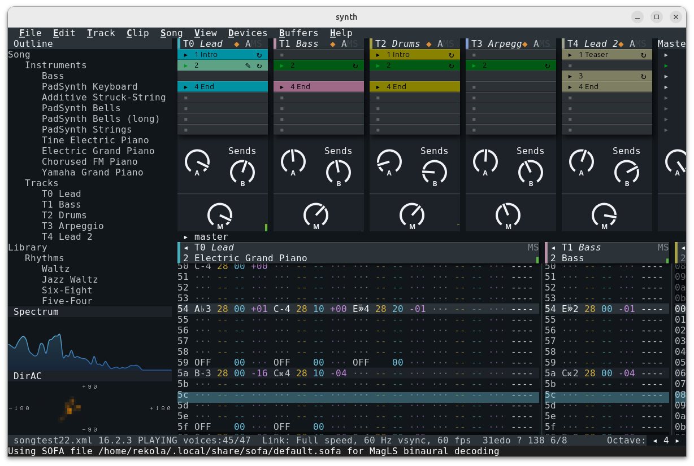

# synth

A microtonal, multiparadigm music production system that combines a live sequencer with a traditional tracker.

## Features

- Live sequencer with sample and note based clips
- Microtonal: 12, 19, 24, 31 or 53 equal divisions of the octave (EDO)
- Just intonation (static only)
- SoundFont 2 (General MIDI) instruments
- Headless mode (for art installations or escape rooms)
- 3D spatial audio (ambisonics), heard binaurally on headphones
- Emacs-style buffers and keybindings
- Works out of the box: basic instruments are built in and no low-latency audio setup is needed
- Keyboard driven
- Launchpad support

## Background

The application draws on several traditions.

- **Tracker.** Music is written as rows in a grid, one column per voice. Chris
  Hülsbeck's Soundmonitor (1986, Commodore 64) already had this layout, its
  steps scrolling up the screen as the music played. It probably inspired
  Ultimate Soundtracker (Karsten Obarski, 1987, Amiga), usually counted the
  first tracker: four channels, each row a note, a sample and an effect.
  Scream Tracker 3 and FastTracker 2 (both 1994) added a volume column, Scream
  Tracker 3 and Impulse Tracker brought lettered effect commands, and Renoise
  (2002) has several note columns per track and a delay column. The
  application's pattern editor follows the later trackers; see
  [docs/commands.md](docs/commands.md).
- **Live sequencer.** Live View holds a clip launcher: a grid of clips, one
  column per track, launched on the bar and grouped into scenes; see
  [docs/launchpad.md](docs/launchpad.md) and [docs/scenes.md](docs/scenes.md).
- **Pad controllers and samplers.** The Launchpad's buttons partly follow
  Novation's layouts, and the 4x4 grid of drum pads was first used in the
  Akai MPC (1988); see
  [docs/drums-and-sequencer.md](docs/drums-and-sequencer.md).
- **FM synthesis.** The FM instruments use John Chowning's frequency
  modulation (1973). A few of them are approximations of individual factory
  voices of the Yamaha DX7 (1983), the synthesizer that made FM widespread,
  standing in for a handful of General MIDI programs. See
  [docs/fm.md](docs/fm.md).  
- **Command palette.** Every command can be run by typing its name into a
  palette on the last rows of the screen, opened with M-x when using the
  terminal keybindings and with Ctrl+Shift+P when using the GUI ones; the
  list narrows as you type, and Tab completes the name. Running a command by
  name goes back to Emacs (1976, first written as macros for the TECO editor
  by Guy Steele and Richard Stallman; GNU Emacs' first public release was in
  1985), where M-x asks for a name and completes it with Tab. The palette
  itself, a list that matches the typed letters in order and is opened with
  Ctrl+Shift+P, comes from Sublime Text 2 (Jon Skinner, 2011). See
  [docs/user-interface.md](docs/user-interface.md).

## Scales and Tunings

- **Tunings.** A song is tuned to 12, 19, 24, 31 or 53 equal divisions of the
  octave (EDO); a new song starts in 53-EDO, whose fifths are almost pure.
  Jing Fang noted in the first century BC that 53 fifths nearly make 31
  octaves, Nicholas Mercator worked the division out in the 17th century, and
  R. H. M. Bosanquet built a 53-tone harmonium in the 1870s. 31-EDO is the
  meantone tuning that Christiaan Huygens described in 1691 and Adriaan
  Fokker revived: his 31-tone organ, built by Bernard Pels, stood in Teylers
  Museum, Haarlem, from 1950 and is now in the Muziekgebouw aan 't IJ,
  Amsterdam. Drum tracks have no tuning: a note is a General MIDI drum.
  Notes are spelled with sharps, flats, double sharps and double flats
  (plus a comma `↑`/`↓` in 53-EDO, below), and a tuning can spell the same pitch
  in several ways. In 12-EDO, E♯ is F. In 31-EDO, E♯ and F are different pitches,
  but D𝄪 and F𝄫 are the same one. Note numbers for each tuning are in `docs/`,
  for example [53edo_note_numbers.txt](docs/53edo_note_numbers.txt).
- **Notation.** In 12, 19 and 31-EDO the note names are a chain of fifths: the seven
  natural notes C D E F G A B are the usual seven consecutive fifths
  (F C G D A E B), and each further fifth up adds a sharp, each fifth down a
  flat (F♯ is the fifth above B, B♭ the fifth below F). The tuning only decides how
  many steps the fifth and the sharp are. In 31-EDO the fifth is 18 steps, so
  seven fifths less four octaves make a sharp of 2 steps (C♯ = 2, C𝄪 = 4,
  D♭ = 3, D = 5): the notation of the meantone family, in which four fifths
  make a major third (E = 10 steps, near 5:4). A flat is the mirror image, so
  C♯ and D♭ differ by one step. In 12-EDO the sharp is 1 step and the chain
  closes on itself, which is why E♯ is F there. See Fokker, "Equal Temperament
  and the Thirty-one-keyed Organ", *The Scientific Monthly* 81 (1955).
- **53-EDO notation.** Four 53-EDO fifths make the Pythagorean third, a comma
  above 5:4, so its names follow Ben Johnston's just-intonation notation
  instead: the natural notes C D E F G A B are 1/1 9/8 5/4 4/3 3/2 5/3 15/8, a
  sharp or flat is
  25:24 (3 steps) and a `↑` or `↓` after an accidental raises or lowers by the
  syntonic comma 81:80 (1 step), as in A♯↑ (the app draws the combined
  accidental as a single glyph, and the pattern editor colours the comma: one
  hue up, another down). A ratio is spelled by the key nearest it: 7:4 is
  A♯↑ and not A♯, because the tempered A♯↑ lies 5 cents from it and the
  tempered A♯ 18. With these naturals the plain D–A is 40:27, a comma
  short of a fifth; the pure fifth above D is A↑. The other tunings ignore the
  `↑`/`↓`, so a 53-EDO spelling still names the right note in 31-EDO. A
  double sharp or flat is 35:32, 7 steps, not two sharps (6 steps, as
  Johnston has it; C♯ sharpened again is D♭): 35:32 is 31-EDO's double
  sharp too (4 steps), so E𝄫 is 8:7 and B𝄫 12:7 in both tunings and the
  utonal scale has one spelling. Details and the full table:
  [53edo_note_numbers.txt](docs/53edo_note_numbers.txt); see John Fonville,
  "Ben Johnston's Extended Just Intonation: A Guide for Interpreters",
  *Perspectives of New Music* 29/2 (1991).
- **Otonal and utonal.** The application's two default scales. They mirror
  each other around the tonic and are drawn from one gamut of 33 just
  ratios: the 7-limit tonality diamond (every ratio between two of 1, 3, 5
  and 7; Max Meyer, 1929, the smaller form of Harry Partch's diamond in
  *Genesis of a Music*, 1949) and its extension. Each scale is a ladder of complete steps, and an artist can stay
  on a small one or move up and down, even within a song. The smallest is one
  seventh chord: C E G A♯↑ = 4:5:6:7 in **otonal**, C E𝄫 F A♭ in **utonal**,
  its mirror. A second chord gives the 7-note core, C D♯ E F G A A♯↑ = 1/1
  7/6 5/4 4/3 3/2 5/3 7/4 (harmonics 12, 14, 15, 16, 18, 20 and 21 of the F
  a fifth below the tonic), in utonal C E𝄫 E♭ F G A♭ B𝄫. Further steps of 8,
  10, 13 and 18 notes each add a seventh chord or two: the tritone, the
  semitones either side of the tonic, the second degree, and a last pair 35
  cents from the tonic. A chord uses only intervals that are ratios of the
  gamut, and on every step every note has a seventh chord. Nothing drifts:
  each note has one fixed ratio, and no chord holds a near-pure interval.
  Partch's own otonalities and utonalities are chords, not scales; the
  scales, the extension and their chords are the author's own. With just
  intonation every note sounds at its exact ratio; without it, 53-EDO is
  within 7 cents up to 13 notes.
  [extended-diamond.md](docs/extended-diamond.md) has the steps, their
  chords and the gamut.

### Pianos and Just Intervals

Sampled pianos can't play microtonal chords in tune; use a synthesized piano
such as `piano.electric.tine` instead.

The otonal and utonal scales contain septimal intervals (7:6, 7:4, 8:7,
12:7) that traditional scales lack. Two notes sounding together beat unless
the partials they share line up, and these intervals share high partials:
7:4 meets at the lower note's 7th partial, 12:7 at its 12th. A piano
string's partial *n* is about 866·B·n² cents sharp (Fletcher, 1964; B is
10⁻⁴ to 10⁻³), so at B = 4·10⁻⁴ 7:4 is 11 cents off and 12:7 33 cents, and
repitching a sample keeps that error. Melodies are unaffected, as beating
needs simultaneous notes.

The FM electric pianos (`piano.electric.*`, [docs/fm.md](docs/fm.md)) keep their
partials on or very near whole-number multiples of the note. A layer whose
modulator is at a whole-number ratio to the carrier is exactly harmonic. A layer
at 1+ε times the carrier (ε = 0.001 or 0.002) puts partial *n* at n + (n−1)·ε
and, where the lower sidebands fold back, also at n + (n+1)·ε, so shared
partials beat at most a few times ε times the fundamental: under a hertz at
middle C for ε = 0.001. `piano.electric.fm` also has a strike layer at 0.51
times the carrier whose partials are off the harmonics on purpose. What remains
is the tuning's own error, such as 31-EDO's 4:3 being 5.2 cents wide, which
tuning corrections on the notes can remove.

The acoustic piano (`<additive preset="piano"/>`, also `piano.acoustic.grand`
when the SoundFont has no piano; [docs/additive.md](docs/additive.md)) puts partial *n* at
n + (n−1)·ε as well, using harmonic partials with a bounded stretch (ε = 0.003
in its `piano` preset).

## Terminal support

The terminal UI works in any terminal with xterm-style escape sequences, but a
modern one is better. Terminals with the Kitty keyboard protocol (kitty, foot, WezTerm,
Ghostty) report key releases, which keyboard note entry needs to know how long
a note is held, so they can sustain several notes at once. Other terminals
can't tell how long a note is held, but keys typed within about 0.1 s of each
other still form a chord, on one row. Terminals with Kitty graphics or Sixels get pixel graphics:
the spectrum analyzer and the DirAC heatmap in the scopes are drawn as real
pixels instead of braille cells, and without pixel support they fall back to
braille. See [docs/user-interface.md](docs/user-interface.md#terminal) for terminal-specific setup.

Known to work are kitty, xterm and GNOME Terminal. The full table is in
[docs/user-interface.md](docs/user-interface.md#supported-terminals).

## Launchpad support

A connected Novation Launchpad (Mini MK3 / X) becomes a drum rack or isomorphic
keyboard, a step sequencer and a clip launcher. See
[docs/launchpad.md](docs/launchpad.md) for the layout, colors and every button.

## Third-party code

This project is MIT-licensed (`LICENSE`). It vendors a small amount of
third-party source under `third_party/` (currently `tinyxml2`, zlib
license, and PocketFFT, BSD-3-Clause - the FFT backend behind
`src/dsp/RealFFT.h`) and dynamically links against several
permissively/LGPL-licensed system libraries. See `THIRD_PARTY_LICENSES.md`
for the full picture, or run `synth --licenses` to print it.

## Roadmap / missing functionality

The major things that are missing are the following:

* A proper name
* Lighting control (DMX/ArtNet)
* Continuous MIDI recording with retroactive capture
* Collaborative Editing

### Minor Missing Features

* DirAC heatmap marker overlay for every active spatial object, not just track positions — track azimuth/elevation markers, plus Granular Cloud grains and other shared-bus-effect taps (FDNReverb, MultiTapDelay)
* DC Filter and Soft Clipping
* 5.1 or 7.2 modes in addition to binaural headphone mode
* Legato voicing mode
* Custom drum kits without SoundFont: map individual percussion keys to arbitrary instruments instead of one whole SF2 kit preset.
* Binary storage for samples and cover art
* Instrument editor
* Track effect editor
* Allocation-free and realtime-priority renderer
* New recordings are initially drafts and can then be either merged or promoted to a clip
* Ambient textures (waves, campfire, thunder, rain etc.)
* Clip launch modes
